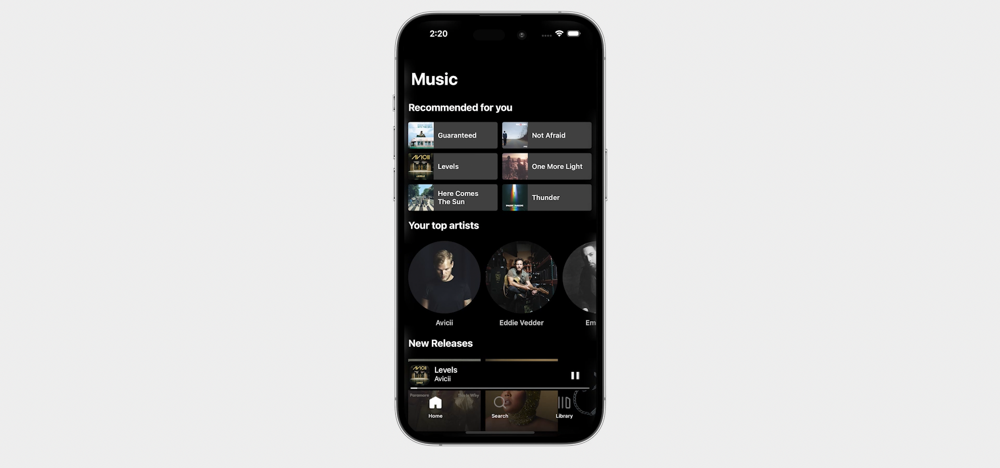
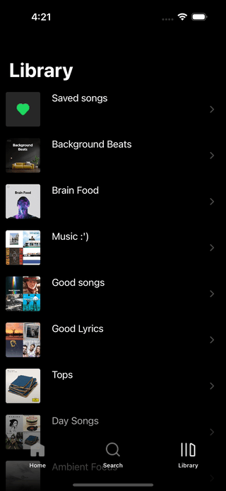

# Spotify Client | Swift & UIKit

Online Music Player for iOS based on Spotify

API: https://developer.spotify.com/documentation/web-api/



## Features 
- Recommended tracks
- Top artists
- New releases
- Playlists / Featured playlists
- Explore categories
- Search songs, artists, playlists, albums
- Save / Delete songs
- Shuffle
- Repeat

### Stack
- UIKit
- Spotify Web API

## Screenshots


| Home | Search | Library |
|  --- |  ---   |   ---   |
||||
 

## Setup project

1. Go to Spotify and create an App so you get the ClientID and Client Secret 
https://developer.spotify.com/documentation/general/guides/authorization/app-settings/
 
2. Copy the values to the file Utils/Constants.swift  
 
```bash
    static let clientID = "YOUR_CLIENT_ID"
    static let clientSecret = "YOUR_CLIENT_SECRET"
```

3. Run the project with Xcode

---

Inspired by tutorials from iOS Academy:
https://www.youtube.com/playlist?list=PL5PR3UyfTWve9ZC7Yws0x6EGjBO2FGr0o
